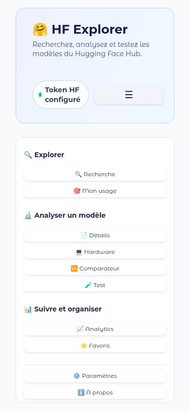

# 🤗 HF Explorer (Huggor)

Rechercher, examiner, comparer et évaluer les modèles du Hugging Face Hub depuis une interface web, avec un verdict clair : *ce modèle tient-il sur ma machine ?*

**Démo en ligne : <https://huggor.onrender.com/>** — la première visite peut prendre 30 à 50 secondes (tier gratuit en veille). · [Documentation](docs/index.md) · [Releases](https://github.com/nouhailler/huggor/releases)

## Aperçu

### Recherche par mot-clé, domaine et tâche


### Fiche technique complète et Huggor Score


### Comparateur décisionnel


### Calculateur de ressources (Hardware)


### Menu mobile



## Fonctionnalités

### 🔍 Explorer
- Recherche par mot-clé, **domaine** (🧠 LLM, 👁️ Vision, 🖼️ Image, 🎙️ Audio, 🗣️ Speech, 🔤 Embeddings, 🌐 Multimodal, 🧩 Reranking) puis **tâche précise**, langue et licence
- Filtre par plage de paramètres, tri (téléchargements, likes, date, pertinence), 5 à 100 résultats
- 🎯 **Mon usage** : recherche par objectif (Chatbot, Coding, RAG, Traduction…) croisée avec votre RAM/VRAM pour ne remonter que des modèles jouables sur votre machine, avec un bouton « ⭐ Pin » vers les favoris

### 🔬 Analyser un modèle
- **Fiche technique** : identité, architecture, précisions et quantifications détectées (FP32 à Q2, GPTQ, AWQ, EXL2, MLX), compatibilités d'exécution, Model Card complète, inventaire et arborescence des fichiers, recommandation des poids à télécharger
- **[Huggor Score](src/huggor_score.py)** sur 100, toujours accompagné du détail de ses neuf composantes (popularité, fraîcheur, documentation, licence, Safetensors, quantification, compatibilité locale, taille, maturité)
- **Model Advisor** : verdict d'adéquation matérielle selon la précision, versions déjà quantifiées sur le Hub, modèles similaires
- 💻 **[Hardware](src/ui/hardware_tab.py)** : quelles précisions tiennent réellement dans votre RAM/VRAM, avec vitesse et contexte estimés (présentés comme théoriques)
- 🆚 **Comparateur** de 2 à 4 modèles : tableau critère par critère, recommandation motivée, tableau technique complet et radar
- Snippets prêts à l'emploi (usage local et `InferenceClient`)

### 📊 Suivre et organiser
- ⭐ **[Favoris](src/ui/favorites_tab.py)** : collections, tags, statut, note personnelle, date du dernier test et commentaire
- 📈 **[Analytics](src/ui/analytics_tab.py)** : tendances curatées (🔥 plus téléchargés, ❤️ plus appréciés, 🆕 récents, 🇫🇷 français, 💻 optimisés local), détection de « Rising models » fondée sur vos propres observations locales, analyse par filtres. Les statistiques portent sur l'échantillon chargé (50 résultats), pas sur tout le Hub ; le radar n'est pas une mesure de qualité
- 🗄️ **[Gestion du cache](src/cache_manager.py)** par domaine (aperçu entrées/taille/fraîcheur, purge ciblée) et bouton « 🔄 Actualiser depuis Hugging Face » dans la fiche

### 🧰 Confort d'utilisation
- **Mode hors connexion** : si le Hub est injoignable, un bandeau « 🟠 Mode hors connexion » apparaît et recherches, fiches et comparaisons déjà consultées restent disponibles depuis le cache local
- **Menu hamburger (☰)** sur petit écran, regroupant les fonctionnalités par catégorie — une seule interface responsive, sans mode séparé mobile/desktop
- **⚙️ Paramètres** (visite guidée en 5 étapes à la demande), **ℹ️ À propos** (version, commit, support, crédits des dépendances) et **⚖️ Mentions légales** — voir [`src/onboarding.py`](src/onboarding.py), [`src/app_info.py`](src/app_info.py), [`src/legal_notice.py`](src/legal_notice.py)

> L'onglet 🧪 Test (test d'inférence) est un espace réservé : il n'est pas encore implémenté.

## Installation

Prérequis : Python 3.10 ou supérieur. Un token Hugging Face est facultatif pour les modèles publics, nécessaire pour les ressources privées ou protégées.

```bash
python3 -m venv .venv
source .venv/bin/activate
pip install -r requirements.txt
cp .env.example .env
```

Renseignez `HF_TOKEN` dans `.env`, ou authentifiez la machine avec `hf auth login`. Ne versionnez jamais le fichier `.env`.

### Lancement

```bash
python app.py
```

L'interface est disponible par défaut sur <http://127.0.0.1:7860>. `GRADIO_SERVER_NAME` et `GRADIO_SERVER_PORT` permettent de modifier cette adresse.

### Paquet Debian / Ubuntu

Téléchargez le `.deb` depuis les [releases GitHub](https://github.com/nouhailler/huggor/releases), puis :

```bash
sudo apt install ./hf-explorer_0.1.0_all.deb
hf-explorer
```

Python 3.10+ requis (Ubuntu 22.04+, Debian 12+). Le premier lancement nécessite Internet pour installer les dépendances dans un environnement isolé : gardez le terminal ouvert, puis ouvrez `http://127.0.0.1:7860`. Arrêt avec `Ctrl+C`. L'entrée **HF Explorer** du menu des applications ouvre aussi le lanceur.

Environnement et données sont conservés dans `${XDG_DATA_HOME:-~/.local/share}/hf-explorer/` (modifiable via `HF_EXPLORER_DATA_DIR`) ; les mises à jour et la désinstallation les préservent. Pour un token : `export HF_TOKEN=…` avant `hf-explorer`, ou `hf auth login`. Pour reconstruire le paquet : `python3 scripts/build_deb.py --version 0.1.0` (résultat dans `dist/`).

## Déploiement sur Render

Hébergement gratuit d'un vrai processus Python persistant, mis en veille après 15 minutes d'inactivité. C'est la cible de la [démo en ligne](https://huggor.onrender.com/). Le fichier [`render.yaml`](render.yaml) décrit le service (Blueprint) ; Render fournit le port via `$PORT`, d'où la commande de démarrage :

```yaml
startCommand: GRADIO_SERVER_NAME=0.0.0.0 GRADIO_SERVER_PORT=$PORT python app.py
```

1. Sur <https://dashboard.render.com> : **New → Blueprint**, connectez le dépôt GitHub `nouhailler/huggor`.
2. Renseignez le secret `HF_TOKEN` dans les paramètres du service si des ressources privées ou protégées doivent être accessibles (déclaré avec `sync: false` : jamais dans le dépôt).
3. Render installe `requirements.txt`, lance l'application et l'expose sur `https://<nom-du-service>.onrender.com`.

Réserves : stockage éphémère (`data/cache/`, `data/analytics/`, `data/favorites.json` réinitialisés à chaque redémarrage ou mise en veille, sauf disque persistant payant) ; délai de 30 à 50 secondes au premier visiteur après une veille ; le mode PWA de Gradio n'est pas activé automatiquement (`pwa=True` dans `launch()` si souhaité).

## Déploiement sur Hugging Face Spaces

Techniquement possible sans modification du code (l'application lit `GRADIO_SERVER_NAME`/`GRADIO_SERVER_PORT` et résout le token via `huggingface_hub`), mais **déconseillé sans abonnement PRO** : héberger un Space Gradio sur le matériel gratuit **CPU Basic** l'exige, et **ZeroGPU** impose une fonction `@spaces.GPU` que Huggor n'a pas. Pour un Space, il faut en outre ajouter ce bloc YAML en tête de ce fichier :

```yaml
---
title: HF Explorer
emoji: 🤗
colorFrom: indigo
colorTo: blue
sdk: gradio
sdk_version: 6.26.0
app_file: app.py
pinned: false
---
```

Puis : créer le Space (SDK **Gradio**) sur <https://huggingface.co/new-space>, `git remote add space https://huggingface.co/spaces/<compte>/<nom>` et `git push space main`, et renseigner `HF_TOKEN` dans **Settings → Repository secrets** si besoin. Le stockage est éphémère comme sur Render ; Gradio y active automatiquement le mode PWA.

## Utilisation du client API

```python
from src.api_client import HuggingFaceClient, SearchFilters

client = HuggingFaceClient()
models = client.search_models(
    SearchFilters(query="bert", pipeline_tag="text-classification", language="fr", sort="downloads", limit=20)
)

details = client.get_model_info("google-bert/bert-base-multilingual-cased")
card_markdown = client.get_model_card("google-bert/bert-base-multilingual-cased")
```

Chaque recherche impose une limite de 5 à 100 résultats. Les réponses sont conservées dans `data/cache/` avec une durée de vie configurable.

## Tests

Isolés du réseau, bibliothèque standard uniquement :

```bash
python -m unittest discover -s tests -v
```

## Documentation

La documentation complète (guide par onglet, fonctionnalités, données, mode hors connexion, dépannage, FAQ, versions) est dans [`/docs`](docs/index.md). Mentions légales : [docs/legal.md](docs/legal.md).
