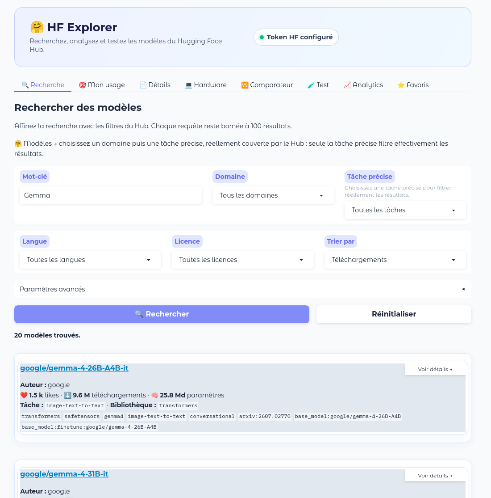
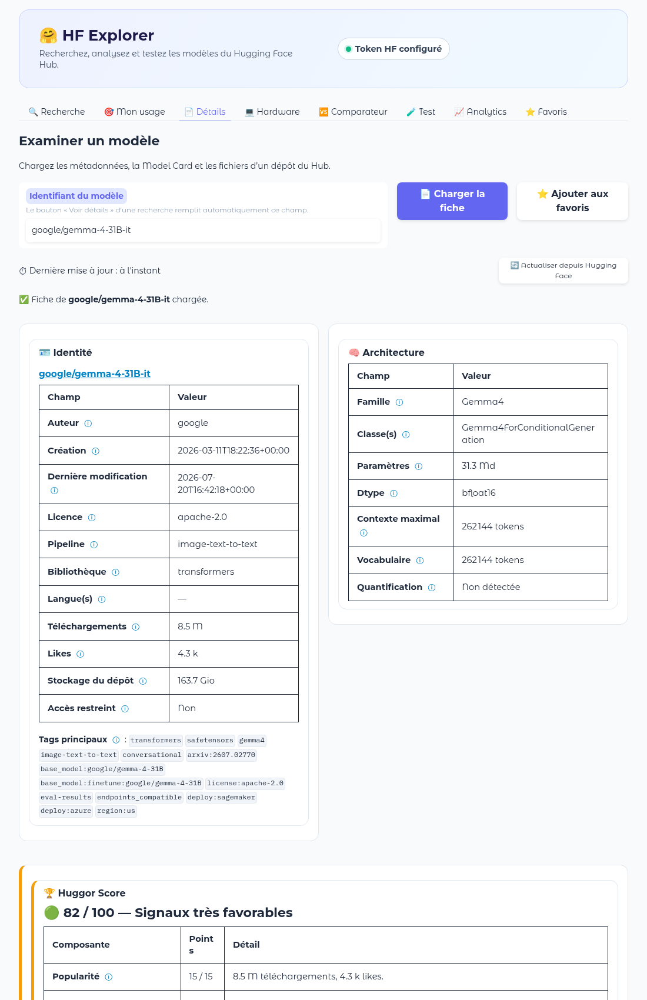
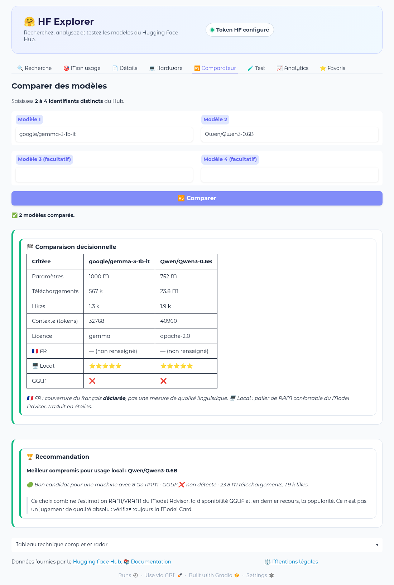
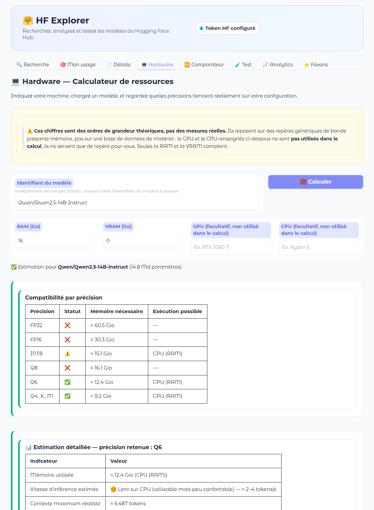

# 🤗 HF Explorer

[](https://github.com/nouhailler/huggor/releases)


**HF Explorer** (dépôt `huggor`) est une application web, écrite en Python avec [Gradio](https://www.gradio.app/), pour explorer, analyser et comparer les modèles du [Hugging Face Hub](https://huggingface.co/models), et savoir *si un modèle tient sur sa propre machine*.

**▶ Démo en ligne : <https://huggor.onrender.com/>** (première visite : 30 à 50 secondes, le tier gratuit se met en veille) · [Documentation](docs/index.md) · [Releases](https://github.com/nouhailler/huggor/releases)

## Présentation

Choisir un modèle sur le Hub oblige à ouvrir de nombreuses fiches et à deviner si l'on pourra l'exécuter. HF Explorer s'adresse aux personnes qui veulent **choisir un modèle à exécuter en local** (développeurs, curieux, équipes qui évaluent des options) sans maîtriser le jargon du Hub.

À partir des métadonnées publiques du Hub, l'application ajoute à la recherche :

- une **fiche technique** lisible : architecture, précisions et quantifications détectées, fichiers, Model Card ;
- une **estimation RAM/VRAM** selon la précision (FP32 à Q4_K_M) et un verdict d'adéquation à votre machine ;
- un **comparateur** de 2 à 4 modèles avec recommandation motivée ;
- un **Huggor Score** sur 100, toujours accompagné du détail de ses composantes ;
- des **favoris** organisés en collections et un **observatoire** de tendances construit localement.

Les estimations sont des ordres de grandeur, pas des garanties : voir [Limites connues](#limites-connues).

## Aperçu

### Recherche
Recherche par mot-clé, domaine, tâche précise, langue et licence.



### Fiche détaillée d'un modèle
Identité, architecture, Huggor Score et compatibilité matérielle.



### Comparateur
Tableau critère par critère et recommandation du meilleur compromis pour un usage local.



### Estimation des besoins matériels
Précisions qui tiennent dans la RAM/VRAM déclarée, avec vitesse et contexte estimés.



L'interface est responsive : sur petit écran, un menu ☰ remplace la barre d'onglets ([capture du menu mobile](docs/assets/screenshots/mobile-menu.png)).

## Fonctionnalités

| Catégorie | Fonctionnalité | État |
|---|---|---|
| **Explorer** | Recherche par mot-clé, domaine puis tâche précise, langue, licence ; plage de paramètres ; tri ; 5 à 100 résultats | Opérationnel |
| | 🎯 Mon usage : recherche par objectif (Chatbot, Coding, RAG, Traduction…) croisée avec RAM/VRAM | Opérationnel |
| **Analyser** | Fiche technique, Model Card, inventaire des fichiers, recommandation des poids à télécharger, snippets de code | Opérationnel |
| | Détection des précisions et quantifications (FP32 à Q2, GPTQ, AWQ, EXL2, MLX) | Opérationnel |
| | Variantes déjà quantifiées et modèles similaires sur le Hub | Heuristique (fondé sur les métadonnées) |
| | Huggor Score /100 avec détail de ses neuf composantes | Opérationnel |
| **Comparer** | Comparaison de 2 à 4 modèles, recommandation motivée, radar | Opérationnel |
| **Utilisation locale** | Model Advisor et calculateur Hardware (RAM/VRAM) | Opérationnel, estimations théoriques |
| **Organiser** | ⭐ Favoris : collections, tags, statut, note, dernier test, commentaire | Opérationnel |
| **Observer** | 📈 Analytics : tendances curatées, « Rising models », répartitions | Opérationnel, sur échantillon de 50 résultats |
| | 🗄️ Gestion du cache par domaine, actualisation forcée | Opérationnel |
| **Confort** | Mode hors connexion (secours depuis le cache), menu mobile, visite guidée (⚙️ Paramètres), ℹ️ À propos, ⚖️ Mentions légales | Opérationnel |
| **Tester** | 🧪 Test d'inférence | **Non implémenté** (espace réservé) |

Le détail, onglet par onglet : [Guide utilisateur](docs/guide.md) et [Fonctionnalités](docs/features.md).

## Démarrage rapide

Prérequis : Python 3.10 ou supérieur et Git.

```bash
git clone https://github.com/nouhailler/huggor.git
cd huggor
python3 -m venv .venv
source .venv/bin/activate
pip install -r requirements.txt
cp .env.example .env
python app.py
```

Ouvrez ensuite <http://127.0.0.1:7860>. Au premier affichage, un avertissement légal demande de cliquer sur « J'ai compris ». Le champ de recherche est pré-rempli avec « Gemma » : appuyez sur Entrée.

### Token Hugging Face

- **Facultatif** pour les modèles publics. **Nécessaire** pour les dépôts privés ou « gated » (conditions à accepter) ; sans token, l'en-tête affiche « Accès public ».
- **Configuration** : renseignez `HF_TOKEN` dans `.env`, ou authentifiez la machine avec `hf auth login`.
- **Ne le publiez jamais** : `.env` est ignoré par Git (`.gitignore`) ; ne copiez pas un token dans une issue, une capture d'écran ou un commit.

### Installation en une commande (Linux)

Sans cloner le dépôt, ni `sudo` : l'installateur télécharge la dernière release depuis [huggor-downloads](https://github.com/nouhailler/huggor-downloads), vérifie son SHA-256 et installe l'application dans `~/.local`.

```bash
curl -fsSL https://raw.githubusercontent.com/nouhailler/huggor-downloads/main/install.sh | bash
```

Lancez ensuite `huggor` et ouvrez <http://127.0.0.1:7860>. Prérequis : Python 3.10+ avec son module `venv`, et Internet au premier lancement. Options, mise à jour et désinstallation : [docs/packaging-debian.md](docs/packaging-debian.md).

### Autres modes d'installation

[Paquet Debian/Ubuntu](docs/packaging-debian.md), [Render](docs/deployment-render.md), [Hugging Face Spaces](docs/deployment-huggingface.md).

## Configuration

Variables d'environnement principales (toutes facultatives) :

| Variable | Rôle | Défaut |
|---|---|---|
| `HF_TOKEN` | Token Hugging Face | aucun (accès public) |
| `GRADIO_SERVER_NAME` | Adresse d'écoute | `127.0.0.1` |
| `GRADIO_SERVER_PORT` | Port d'écoute | `7860` |
| `HF_EXPLORER_DATA_DIR` | Répertoire du cache, des analytics et des favoris | `data/` du dépôt |

Liste complète et détails : [docs/configuration.md](docs/configuration.md). Réglages de l'interface : [docs/settings.md](docs/settings.md).

## Utilisation

Parcours typique :

1. Lancez l'application et ouvrez l'onglet **🔍 Recherche** (ou **🎯 Mon usage** si vous partez d'un objectif et de votre RAM/VRAM).
2. Lancez une recherche, puis cliquez sur **Voir détails →** pour ouvrir la fiche technique et le Huggor Score.
3. Dans **🆚 Comparateur**, saisissez 2 à 4 identifiants (ex. `google/gemma-3-1b-it` et `Qwen/Qwen3-0.6B`) pour obtenir une recommandation.
4. Dans **💻 Hardware**, indiquez votre RAM/VRAM et un modèle pour voir quelles précisions tiennent.
5. Cliquez sur **⭐ Ajouter aux favoris** pour le retrouver dans **⭐ Favoris**.

### Client Python

Le module `src/api_client.py` est une **couche interne** de l'application, sans garantie de stabilité : il n'est pas publié comme bibliothèque.

```python
from src.api_client import HuggingFaceClient, SearchFilters

client = HuggingFaceClient()
models = client.search_models(
    SearchFilters(query="bert", pipeline_tag="text-classification", language="fr", sort="downloads", limit=20)
)

details = client.get_model_info("google-bert/bert-base-multilingual-cased")
card_markdown = client.get_model_card("google-bert/bert-base-multilingual-cased")
```

Chaque recherche impose une limite de 5 à 100 résultats ; les réponses sont mises en cache dans `data/cache/` (15 minutes pour les recherches par défaut).

## Architecture

Python, Gradio 6, `huggingface-hub`, `pandas`, `plotly`. Les données (cache avec TTL, favoris, observations) sont des fichiers JSON locaux ; aucune base de données.

```text
huggor/
├── app.py        # point d'entrée Gradio
├── src/          # logique métier ; src/ui/ = un module par onglet ; src/utils/ = cache, favoris
├── tests/        # tests unitaires
├── data/         # cache, analytics, favoris
├── docs/         # documentation
├── packaging/    # lanceur Debian
├── scripts/      # construction du .deb
├── render.yaml   # déploiement Render
└── requirements.txt
```

Détail des modules et flux de données : [docs/architecture.md](docs/architecture.md).

## Tests et qualité

```bash
python -m unittest discover -s tests -v
```

203 tests unitaires (`unittest`, bibliothèque standard), isolés du réseau ; ils couvrent la logique métier, les onglets et la navigation de l'interface. Les parcours interactifs dans le navigateur (avertissement légal, menu, visite guidée) sont vérifiés manuellement : il n'y a pas de tests d'interface automatisés. Il n'existe pas non plus d'intégration continue (pas de workflow GitHub Actions) ni de linter configuré à ce jour.

## Déploiement

| Cible | Statut | Guide |
|---|---|---|
| Local | Référence | [Démarrage rapide](#démarrage-rapide) |
| Linux (installateur) / Debian / Ubuntu | Commande `curl` ou paquet `.deb` publié dans [huggor-downloads](https://github.com/nouhailler/huggor-downloads/releases) | [docs/packaging-debian.md](docs/packaging-debian.md) |
| Render | Utilisé pour la [démo](https://huggor.onrender.com/), tier gratuit | [docs/deployment-render.md](docs/deployment-render.md) |
| Hugging Face Spaces | Déconseillé sans abonnement PRO | [docs/deployment-huggingface.md](docs/deployment-huggingface.md) |

Sur les hébergements gratuits, le stockage est éphémère : cache, analytics et favoris sont réinitialisés à chaque redémarrage.

## Roadmap

Les étapes numérotées viennent du cahier des charges initial (`Projet Application Gradio.md`). Aucune date n'est promise.

| Fonctionnalité | État | Commentaire |
|---|---|---|
| Étapes 1 à 5 : client Hub, interface, recherche, détails, comparateur, Analytics | Terminée | |
| Étape 7 : favoris | Terminée | Collections, tags, statut, note, commentaire |
| Compléments : Huggor Score, Mon usage, Hardware, cache, mode hors connexion, menu mobile | Terminée | Ajoutés au-delà du plan initial |
| Étape 6 : test d'inférence | Prévue | Onglet 🧪 Test = espace réservé |
| Mode PWA hors Hugging Face Spaces | Non activé | Possible via `pwa=True` dans `app.py` ; pas décidé |
| Export des favoris | Non prévu à ce jour | Le fichier `data/favorites.json` reste copiable à la main |
| Intégration continue, licence | À décider par le propriétaire | Voir [Licence](#licence-et-crédits) |

Historique des évolutions : [CHANGELOG.md](CHANGELOG.md) (version 0.1.0) et [docs/versions.md](docs/versions.md) (0.1.0 à aujourd'hui).

## Confidentialité et sécurité

- **Aucun compte, aucune donnée personnelle collectée** par l'application elle-même.
- **Stocké localement (côté serveur)** : cache des réponses du Hub (`data/cache/`), observations Analytics (`data/analytics/`), favoris (`data/favorites.json`). Sur une instance partagée comme la démo, ces fichiers sont ceux de l'instance. Deux clés du navigateur (`localStorage`) mémorisent l'avertissement légal et la visite guidée.
- **Échanges réseau** : l'application interroge l'API du Hugging Face Hub (recherches, fiches, Model Cards). Les valeurs RAM/VRAM saisies ne sont pas envoyées au Hub.
- **Token** : utilisé uniquement pour authentifier les requêtes vers le Hub ; jamais affiché ni journalisé. Le cache distingue accès anonyme et authentifié par une empreinte SHA-256 tronquée, sans conserver le token.
- **Télémétrie de Gradio** : Gradio active par défaut sa propre télémétrie anonyme (`GRADIO_ANALYTICS_ENABLED`, défaut `True` dans le code de Gradio) ; Huggor ne la désactive pas. Pour la couper : `GRADIO_ANALYTICS_ENABLED=False`.
- **Fichier d'exemple** : `.env.example` ne contient qu'une valeur fictive.
- **Signaler une faille** : [SECURITY.md](SECURITY.md). Détails : [Données](docs/data.md), [Permissions](docs/permissions.md), [Informations légales](docs/legal.md).

## Limites connues

**Inhérentes aux estimations**
- Les verdicts RAM/VRAM, vitesses et contextes sont **théoriques** : ils reposent sur des repères génériques de bande passante mémoire, pas sur une mesure de votre GPU/CPU. La mémoire réellement nécessaire dépend du moteur d'inférence, de la longueur de contexte et du système. Ce n'est jamais une garantie de fonctionnement.
- Les métadonnées du Hub sont déclaratives : une langue, une licence ou une quantification peuvent être absentes ou inexactes ; le score et le radar ne mesurent pas la qualité d'un modèle.
- Les statistiques Analytics portent sur l'échantillon chargé (jusqu'à 50 résultats), pas sur tout le Hub ; l'historique de croissance commence au premier chargement.

**Propres à l'implémentation**
- Onglet 🧪 Test non implémenté.
- Variantes quantifiées et modèles similaires reposent sur des heuristiques de recherche.
- Pas de synchronisation entre installations ; stockage éphémère sur les hébergements gratuits.
- Le Hub peut limiter les requêtes (erreur 429) ; le mode hors connexion ne sert que ce qui a déjà été consulté.

Liste complète : [docs/reference.md](docs/reference.md#limites-connues).

## Contribuer et obtenir de l'aide

- 🐞 [Signaler un bug ou demander une fonctionnalité](https://github.com/nouhailler/huggor/issues/new)
- 🔀 [Pull requests](https://github.com/nouhailler/huggor/pulls) : voir [CONTRIBUTING.md](CONTRIBUTING.md)
- 🔒 Vulnérabilité : [SECURITY.md](SECURITY.md)
- 🛠️ [Dépannage](docs/troubleshooting.md), [FAQ](docs/faq.md), [Support](docs/support.md)

## Licence et crédits

**Aucun fichier `LICENSE` n'est présent dans le dépôt** : sans licence explicite, le code n'est pas réutilisable par défaut. Le choix d'une licence appartient au propriétaire du projet.

Éditeur : Swinux ([swinux.ch](https://swinux.ch)) — voir les [mentions légales](docs/legal.md). Construit avec [Gradio](https://www.gradio.app/), [huggingface_hub](https://github.com/huggingface/huggingface_hub), [pandas](https://pandas.pydata.org/), [Plotly](https://plotly.com/python/) et [python-dotenv](https://github.com/theskumar/python-dotenv) ; données fournies par le [Hugging Face Hub](https://huggingface.co/). Crédits et licences des dépendances : écran « ℹ️ À propos » de l'application.

La documentation complète est dans [`/docs`](docs/index.md).
